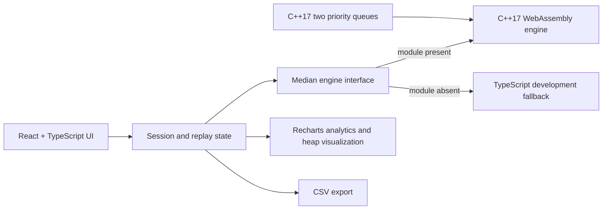

# LiveScore Analytics

**Every score matters. Every median updates.** A browser based, insert only score stream that demonstrates online median maintenance with two heaps, visualizes every prefix median, accepts replay files, and compares the heap approach with repeated sorting.

## Problem and approach

Judges submit competition scores as events finish. Sorting every score seen so far after every submission wastes work, and a few outliers can pull the arithmetic mean away from typical performance. The median is the middle value after ordering observations. Online statistics update that value as each observation arrives, without waiting for the complete dataset.

The engine maintains two priority queues:

- **Max heap `lower`** stores the smaller half; its root is the largest score in that half.
- **Min heap `upper`** stores the larger half; its root is the smallest score in that half.

The invariants after every insertion are `lower.top() <= upper.top()` whenever both heaps are nonempty, and `lower.size() == upper.size()` or `lower.size() == upper.size() + 1`. To insert, compare the score to the lower root, push it into the appropriate heap, and transfer a root if needed to restore balance. For an odd count, the median is `lower.top()`. For an even count, it is `(int64(lower.top()) + int64(upper.top())) / 2.0`; widening before addition prevents 32-bit overflow and retains fractional medians. The two roots are sufficient because the invariants make them the two values at the center of the fully ordered stream.

| Operation                                                   |                      Cost |
| ----------------------------------------------------------- | ------------------------: |
| Insert / rebalance                                          |                  O(log n) |
| Read median                                                 |                      O(1) |
| Storage                                                     |                      O(n) |
| Process n scores                                            |                O(n log n) |
| Re-sort all k scores after each insertion (sum over stream) | approximately O(n² log n) |

The repeated-sort bound is a coarse upper estimate: summing `O(k log k)` over each prefix through n yields `O(n² log n)`.

## Architecture



The C++17 engine in `cpp/median_engine.*` is compiled to `public/wasm/median_engine.js` and `.wasm` with Emscripten. `src/engine.ts` dynamically loads that module and exposes it through a small engine interface. The UI reports **C++17 WebAssembly · Emscripten** when that module initializes successfully. If the module is absent or fails to load, the interface switches to the separately labeled TypeScript development fallback. Both paths use the same insertion/result contract.

## Features

- Overview and live scoreboard with signed int32 validation, session reset confirmation, heap counts, recent history, and insertion timing.
- CSV/TXT replay parsing with line-level errors, built-in edge case datasets, sequential playback, pause/resume, reset, and selectable interval.
- Median trajectory, score distribution, mean comparison, history table, and CSV export.
- Heap roots and snapshots, ordering/balance invariant status, and complexity explanations.
- In-browser repeated-sort versus heap benchmark with measured timings, plus deterministic edge, randomized differential, and 100,000-score stress validations.
- Responsive React + Vite + TypeScript UI, Tailwind CSS tooling, Recharts, Motion dependency, and Lucide icons.

The benchmark timings are generated on demand in the current browser and are device/load dependent. The test dashboard reports actual results from the current validation run; it does not preload a success state. Starting a replay from position zero resets the active session so replay medians are independent and match the reference; pause/resume continue the same replay without duplication.

## Project structure

```text
src/App.tsx             Interactive dashboard, navigation, replay and analytics
src/App.css             Responsive dark analytics UI
src/engine.ts           WASM adapter, explicit fallback and replay-file parser
src/engine.test.ts      Vitest checks for medians, invariants and parsing
cpp/median_engine.*     C++17 two-heap engine and bounded snapshots
cpp/median_bindings.cpp Embind adapter used by the browser module
public/wasm/            Generated browser JavaScript and WebAssembly
cpp/tests/              Native C++ correctness checks
cpp/CMakeLists.txt      CMake/CTest project
```

## Run locally

Requirements: Node.js 20.19+ (or 22.12+) and npm.

```bash
npm install
npm run dev
```

Vite prints the local URL. For a production bundle, run `npm run build`; use `npm run preview` to serve that bundle locally. The static app can be deployed to Vercel with the Vite preset, build command `npm run build`, and output directory `dist`. No server, database, authentication, or account is required.

## Tests

```bash
npm test
cmake -S cpp -B build
cmake --build build
ctest --test-dir build --output-on-failure
```

If CMake is not installed, the C++ test can also be compiled directly with an available C++17 compiler:

```bash
clang++ -std=c++17 cpp/median_engine.cpp cpp/tests/median_test.cpp -o /tmp/livescore-median-test
/tmp/livescore-median-test
```

The Vitest suite covers sample medians, int32 extreme arithmetic, 10,000 heap invariant checks, and file validation. The in-app suite runs against the active WebAssembly engine when available and checks repeated values, mixed signs, the exact demo sequence, randomized prefix-by-prefix comparison to a sorting reference, and 100,000 inserts. The native C++ test checks the same edge cases plus randomized differential and stress inputs.

## Build the C++ WebAssembly module

Emscripten 7.0.1 was installed and used to produce the checked-in browser module. To regenerate it, install Emscripten 7+ and run:

```bash
npm run build:wasm
```

This runs `em++` with C++17, Embind, ES module output, and browser environment settings. The generated files are written to `public/wasm/` and served as static assets by Vite and Vercel. Run `npm run build` after generation to verify the frontend bundle.

## Replay files and sample

CSV and TXT are accepted. Entries can be separated by newlines, commas, semicolons, or tabs; a simple `score` header is supported. All nonempty values are validated before replay starts, with source line numbers for invalid values. Limits are 100,000 signed 32-bit integers.

Input: `12, -5, 12, 2147483647, -2147483648, 0, 12`  
Expected prefix medians: `12, 3.5, 12, 12, 12, 6, 12`

## Limitations

- WebAssembly median state is held in the browser module's memory. A page refresh starts a new session; persistence is intentionally not included.
- Heap snapshots are capped to 24 displayed near-root values per heap. The history table and graph keep the latest 1,500 points in React state to keep large streams responsive; all entries remain available in session memory and are included in CSV export.
- Starting a replay from position zero clears the active session so the sequence has its own prefix medians; replay Reset also clears that session and returns playback to the start.
